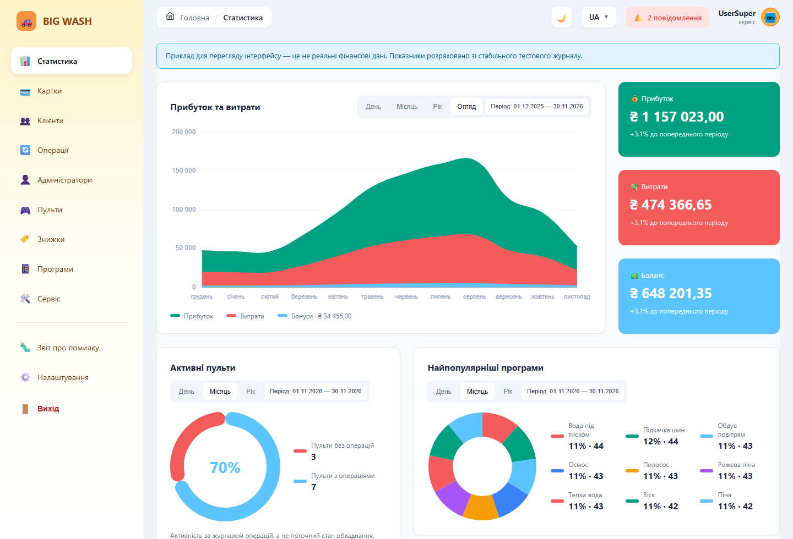

# BigWash — система керування автомийкою

BigWash — особистий full-stack проєкт для керування автомийкою. Автор — Андрій Бобришев. Розробка триває з листопада 2025 року. Цю окрему портфоліо-копію підготовлено для технічного перегляду.

| Частина | Технології |
| --- | --- |
| Вебінтерфейс | SvelteKit 2, Svelte 5, JavaScript, HTML, CSS, Axios, Chart.js |
| Сервер | Go 1.24.3+, Gin, GORM, REST API, JWT, WebSocket |
| База даних | MySQL 8 |

В інтерфейсі є дашборд, клієнти, картки, операції, адміністратори, пульти, програми мийки, знижки, сервісні та загальні налаштування. Початкова мова — українська. У налаштуваннях доступні UA/RU та світла й темна теми.

## Структура

- `frontend/src/routes` містить сторінки SvelteKit, `frontend/src/lib/api` — Axios-клієнт і локальний адаптер, `frontend/tests` — автоматизовані перевірки.
- `backend/cmd/api` — точка входу Go API. Обробники, моделі, middleware та WebSocket розміщені в `backend/internal`. Схему створює `backend/migrations`. У `backend/web` є окремі HTML-сторінки попередньої версії.

## Windows PowerShell · автономний DEV

Потрібні Node.js та npm. Перевірено з Node.js 24. У корені портфоліо виконайте:

```powershell
Set-Location frontend
Copy-Item .env.example .env
npm ci
npm run dev
```

Відкрийте адресу Vite, зазвичай `http://localhost:5173`. При першому вході створіть тестовий обліковий запис на сторінці входу. Стан зберігається в браузері для поточного origin. Для підготовленого набору демонстраційних даних використайте `start-demo.bat` у папці `frontend`. Збірка та preview використовують серверну авторизацію. Для LAN-режиму дивіться інструкцію frontend. [Документація frontend](frontend/README.md)

## Windows PowerShell · Go API та MySQL

1. Створіть окрему порожню базу `bigwash` у MySQL та локального користувача з доступом до схеми і правами на міграцію.
2. Із кореня виконайте `Copy-Item backend/.env.example backend/.env`. Задайте локальні реквізити в `DB_DSN` та унікальний випадковий `JWT_SECRET` довжиною щонайменше 32 символи.
3. Для початкового створення власника задайте `BIGWASH_ENV=development` і `BIGWASH_ENABLE_REGISTRATION=true` у `backend/.env`. DEV API прив’язується до loopback. Реєстрація спрацьовує один раз на порожній таблиці адміністраторів.
4. Запустіть сервер із папки `backend`:

```powershell
go version
go mod download
go run ./cmd/api
```

5. У `frontend/.env` встановіть `VITE_LOCAL_MODE=false`, `VITE_DEMO_MODE=false` та `VITE_API_URL=http://localhost:8080/api/v1`. Запустіть Vite, створіть власника через форму та увійдіть. Вимкніть прапорець реєстрації та перезапустіть API. Якщо адреса Vite відрізняється, додайте її точний origin у `BIGWASH_ALLOWED_ORIGINS`.

Для ізольованої тестової БД власник може додати синтетичні записи через `POST /api/v1/debug/seed` з Bearer JWT після явного встановлення `BIGWASH_ENABLE_DEBUG_SEED=true` у DEV. Вставки виконуються в одній транзакції. WebSocket вмикається через `BIGWASH_ENABLE_WS=true` і перевіряє JWT, роль та Origin. Перед надсиланням події сервер повторно перевіряє активність і поточну роль облікового запису. Для JWT старого формату потрібен повторний вхід.

## Перевірки

| Папка | Команди |
| --- | --- |
| `frontend` | `npm ci`, `npm run check`, `npm run build`, `node --test tests/*.test.mjs` |
| `backend` | `go mod download`, `go test ./...`, `go build -o bigwash-api.exe ./cmd/api` |

Запуск браузерних тестів потребує Chrome та конфігурації адрес тестових серверів. [Документація frontend](frontend/README.md)

## Межі інтеграції

Go API повертає наявну статистику, а для порожньої бази — нульові або порожні показники без запису демонстраційних значень. Go API підтримує читання клієнтів, адміністрування карток і персоналу, статистику, пульти та програми. Запис і видалення клієнтів зі сторінки Svelte доступні в локальному DEV. У серверному режимі список клієнтів завантажується через HTTP. Події Go про картки й обладнання не оновлюють рядки цього списку. Фінансові графіки з журналом сум повністю демонструються в DEV або DEMO. Серверний журнал активності має лише тип, час і опис, тому його записів недостатньо для детальних графіків. Операції, знижки та частину налаштувань і сценаріїв обладнання також варто демонструвати в DEV або DEMO. Артефакт збірки, API та міграції призначені для локальної перевірки. Готовність до production і роботу з фізичним обладнанням ще треба підтвердити. [Зіставлення маршрутизації](frontend/API_CONTRACT.md)

## Скриншот

Дашборд у локальному DEV із синтетичними показниками.



## Використання AI

Я використовую ChatGPT і Codex для аналізу коду, налагодження, тестів і документації. Результати роботи перевіряю в репозиторії.
